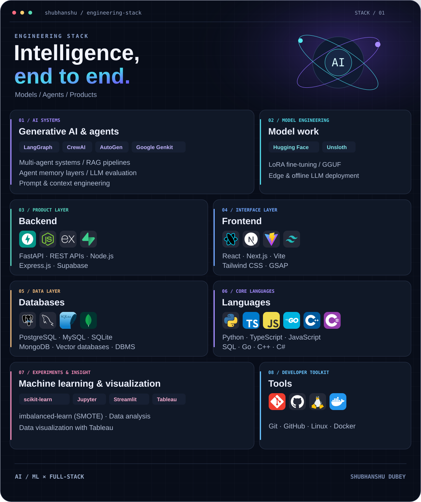

# Shubhanshu Dubey

AI/ML and full-stack engineer. I build GenAI products end to end: the models, the backend and the interface.

[LinkedIn](https://www.linkedin.com/in/shubhanshu-dubey-a53498321) | [Email](mailto:dubeyshubhansu27@gmail.com)

## Currently

- AI Developer Intern at Review AI. Sole engineer on **Aero Limit** (in development), an enterprise B2B platform.
- BTech in AI/ML at Newton School of Technology (ADYPU), graduating 2028.
- Building with LLM agents, RAG, memory layers and on-device models.

## Projects

| Project | Description |
|---|---|
| **Aero Limit** (in development) | Enterprise B2B product, built solo across product, UI, AI and backend |
| [**SmartMed**](https://github.com/shubhanshu2103/AI-Powered-Smart-Health-Report-Management-System) | AI-powered health report management system. React, Tailwind, Supabase (PostgreSQL) |
| **QPSO Routing** | Quantum-inspired particle swarm optimization for vehicle routing (SIH team project) |
| **Nexus-AI** | Solo agentic AI project |
| **Nabha** | Offline AI tutor running on edge devices |
| **EduLens** | AI for education |
| [**algo-vault**](https://github.com/shubhanshu2103/algo-vault) | Algorithm implementations in 6 languages |
| [**Global-Air-Pollution**](https://github.com/shubhanshu2103/Global-Air-Pollution) | Air pollution data analysis in Python |

## Skills

View the full stack as text

**Languages:** Python, TypeScript, JavaScript, SQL, Go, C++, C#

**Generative AI:** multi-agent systems, RAG pipelines, agent memory layers, prompt and context engineering, LLM evaluation

**Agent frameworks:** LangGraph, CrewAI, AutoGen, Google Genkit

**Model work:** LoRA fine-tuning (Unsloth), GGUF quantization, Hugging Face, edge and offline LLM deployment

**Machine learning:** scikit-learn, imbalanced-learn (SMOTE), data analysis with Jupyter, Streamlit

**Backend:** FastAPI, REST APIs, Node.js, Express.js, Supabase

**Databases:** PostgreSQL, MySQL, SQLite, MongoDB, vector databases, DBMS

**Data visualization:** Tableau

**Frontend:** React, Next.js, Vite, Tailwind CSS, GSAP

**Tools:** Git, GitHub, Linux, Docker

## Work with me

Open to paid remote internships and contract work in AI/ML and full-stack. Reach me by email.
